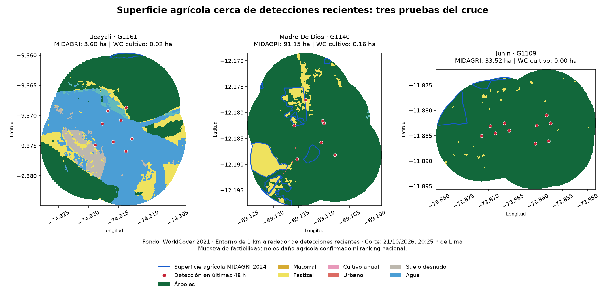

# Preparación de detecciones y piloto agrícola

Corte de las detecciones: **21 de octubre de 2026, 20:25 h de Lima**. Es una captura conservada; las consultas meteorológicas del piloto se realizaron alrededor de las 20:45 h de ese día. No hay ranking agrícola nacional todavía.

## 1. Detecciones preparadas

- 2.727 detecciones nominales/altas dentro de Perú y de las 168 h anteriores al corte.
- 234 detecciones en las últimas 48 h.
- 1.264 agrupaciones aproximadas en siete días; 131 contienen detecciones recientes de las últimas 48 h.
- Una agrupación reciente requiere revisión por actividad repetida durante varios días; no se confirmó que sea un incendio ni se descartó como fuente fija.

Se conectaron parejas a 1 km o menos y a 48 h o menos mediante distancia geodésica WGS84. Es un método por componentes conexos: un grupo puede superar esos límites por encadenamiento. La asignación departamental usa mayoría de detecciones recientes y desempate por código, sin duplicar grupos en el conteo. Las detecciones se cuentan también según su ubicación propia. No se encontraron empates espaciales sobre límites en esta captura.

Los departamentos con más agrupaciones recientes son Ucayali (29), Madre de Dios (22) y Junín (17). **Es una ordenación por conteo, no por peligro meteorológico o exposición agrícola.** Tablas completas en `data/processed/` y resumen metodológico en [PASO_2_DETECCIONES.json](PASO_2_DETECCIONES.json).

## 2. MIDAGRI accesible y manejable

El portal oficial SIEA enlaza `MNSA_2024.rar`. Los metadatos se comprobaron mediante Google Drive; la herramienta tiene un límite de 256 MiB y el archivo pesa aproximadamente 402 MB, por lo que se descargó una única copia mediante el enlace público. El archivo se conserva fuera de Git.

El shapefile extraído tiene 1.827 registros, CRS EPSG:4326 y categoría AGRICOLA. La fuente declarada es interpretación de imágenes Planet y Google Earth de MIDAGRI en 2024. La suma de AREA_HA es 11.248.646,32 ha, coherente con la actualización oficial. Son polígonos agrícolas agrupados administrativamente, no 1.827 parcelas ni registros de cultivo activo hoy. Se conserva la huella SHA-256 del archivo nacional en [MIDAGRI_ACCESO.json](MIDAGRI_ACCESO.json).

## 3. Tres pruebas del cruce

Se eligió la agrupación con más detecciones recientes en cada uno de los tres departamentos con más agrupaciones recientes, excluyendo las marcadas para revisión. Esa regla se fijó antes del cruce agrícola; no se eligieron las zonas por encontrar mucha agricultura.

El entorno es la unión de buffers de 1 km alrededor de las detecciones de las últimas 48 h de cada agrupación, creado en UTM local. La superficie vectorial MIDAGRI se recorta y mide en una proyección de área equivalente. WorldCover se lee en ventanas a su resolución nativa, con NoData excluido; las áreas de píxeles se ponderan geodésicamente. La comparación por centros de píxel puede diferir ligeramente de la intersección vectorial exacta.

| Zona del piloto | Detecciones recientes | Superficie agrícola MIDAGRI 2024 dentro del entorno | Clase cultivo WorldCover 2021 dentro del entorno |
|---|---:|---:|---:|
| Ucayali, G1161 | 8 | 3,60 ha | 0,02 ha |
| Madre de Dios, G1140 | 7 | 91,15 ha | 0,16 ha |
| Junín, G1109 | 10 | 33,52 ha | 0,00 ha |

Las diferencias justifican complementar la clase 40 de WorldCover con la superficie agrícola de MIDAGRI. **No demuestran exactitud superior en cada parcela, cambio de uso entre 2021 y 2024 ni cultivos perdidos.** Parte de la agricultura de MIDAGRI aparece como árboles o pastizales en WorldCover; no se infiere qué especie está cultivada.

La cobertura raster válida fue del 100 % de los píxeles del entorno en los tres recortes. Se reparó una geometría MIDAGRI inválida en el subconjunto de Junín antes de intersectar. El resto del nacional no se declaró validado por esta prueba.

## 4. Meteorología del piloto

Se verificó acceso a ECMWF IFS de 9 km mediante Open-Meteo, con temperatura, humedad, viento y precipitación. Cada punto tiene 168 horas futuras evaluables respecto del corte; las ventanas de lluvia de 24 h incluyen horas anteriores de pronósticos archivados. No son mediciones de estaciones.

| Zona | Máxima de temperatura prevista | Lluvia acumulada prevista en 168 h | Horas del escenario 30/20/2 | Horas del escenario 40/15/2 |
|---|---:|---:|---:|---:|
| Ucayali, G1161 | 34,3 °C | 49,0 mm | 0 | 0 |
| Madre de Dios, G1140 | 34,6 °C | 65,3 mm | 0 | 0 |
| Junín, G1109 | 31,8 °C | 17,8 mm | 0 | 0 |

Los escenarios exigen coincidencia horaria: humedad < 30 % y viento ≥ 20 km/h, o humedad < 40 % y viento ≥ 15 km/h; ambos con lluvia acumulada previa de 24 h < 2 mm. Son cortes exploratorios no calibrados. No se cambiaron para conseguir casos positivos. Cero horas bajo estos cortes no significa que el fuego se extinguirá ni que la agricultura esté segura.

La temperatura elevada, por sí sola, no basta para cumplir estos escenarios. Antes del cálculo nacional deben justificarse y fijarse los criterios finales de comparación, manteniendo la sensibilidad explícita.

## 5. Revisión visual y casos pendientes

La revisión detectó un problema relevante: siete de los ocho puntos del caso de Ucayali caen sobre clase agua en WorldCover 2021. Hay que comprobarlo con imagen óptica más reciente y contexto antes de interpretar esa agrupación como incendio agrícola. Puede influir la antigüedad del mapa, movilidad del cauce o la resolución/geolocalización del sensor; la prueba no determina la causa. No se borrarán detecciones por ese criterio sin revisión.

Esto confirma que la imagen satelital de referencia del dashboard tendrá utilidad analítica, además de visual. La actividad térmica persistente y las localizaciones dudosas se marcarán antes del ranking final.

## 6. Decisiones y siguiente bloque

Usar MIDAGRI 2024 como referencia de superficie agrícola disponible y WorldCover 2021 para describir su cobertura y documentar discrepancias. No sumar ambas superficies. Mantener la pregunta exacta del estudiante y la separación entre cercanía, meteorología y daño observado.

Próximo bloque: revisar las agrupaciones dudosas, cerrar los cortes meteorológicos y probar sensibilidad al buffer; luego ampliar a las agrupaciones recientes con datos válidos. El dashboard se construirá después de contar con una tabla nacional revisada; el 3D es una mejora opcional.
