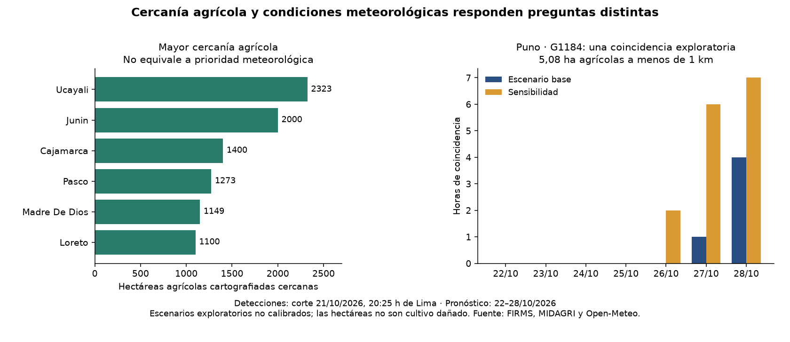
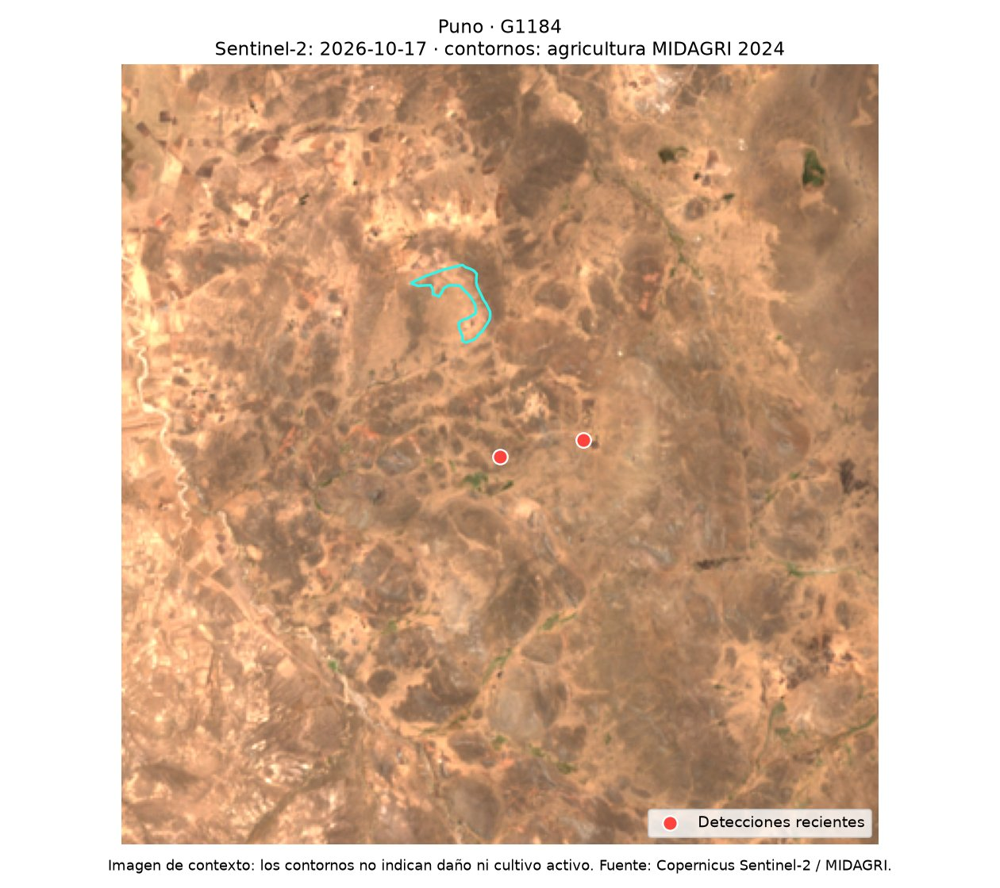

# Resultado nacional: captura del 21 de octubre de 2026

Detecciones: corte 21/10/2026, 20:25 h de Lima. Pronóstico: siete días completos del 22 al 28 de octubre. Escenarios exploratorios, no alerta oficial ni estimación de daños.

## Tres resultados

1. De 131 agrupaciones recientes, 106 tienen superficie agrícola MIDAGRI a menos de 1 km. La superficie cercana suma 12.910,68 ha únicas, evitando contar dos veces áreas que caen en entornos superpuestos. Es cercanía cartográfica, no superficie dañada. Cuatro agrupaciones tienen observaciones pendientes y se separan de la comparación principal.
2. Solo G1184, en Puno, combina agricultura cercana con horas del escenario base: 5,08 ha y cinco horas, previstas el 27 y 28 de octubre. No hay horas base en las primeras 72 h. Ucayali y Junín concentran más superficie agrícola cercana, pero no cumplen el escenario meteorológico base en esta captura.
3. La decisión espacial importa: en Puno hay 0 ha agrícolas dentro de 500 m, 5,08 ha a 1 km y 137,13 ha a 2 km. No existe un resultado independiente de la distancia elegida. El escenario meteorológico alternativo da 15 horas en el mismo grupo.

## Método y límites

Se completaron 131 cruces de cobertura y 168 horas meteorológicas para cada agrupación. El modelo es ECMWF IFS de 9 km, sin ajustar sus temperaturas a una elevación puntual. Las ubicaciones corresponden a 116 celdas distintas. La nubosidad y disponibilidad de imágenes satelitales pueden limitar la revisión visual.

El escenario base exige simultáneamente humedad <30 %, viento ≥20 km/h y lluvia previa de 24 h <2 mm. La sensibilidad usa humedad <40 %, viento ≥15 km/h y la misma lluvia. Estos cortes fueron definidos en el piloto; no son umbrales oficiales calibrados para Perú ni equivalen al FWI de SENAMHI. La temperatura se muestra como contexto y no basta por sí sola para clasificar prioridad.

Se separaron cuatro grupos por actividad repetida o detecciones sobre agua/urbano en WorldCover 2021. No se confirmó la causa de esas señales. Una ausencia de coincidencia no garantiza seguridad agrícola.

La imagen de Puno es Sentinel-2 del 17/10/2026, previa a las detecciones analizadas, con 0 % de píxeles SCL inválidos en el recorte. Sirve de contexto, no prueba incendio, cultivo activo ni daño. MIDAGRI es cartografía agrícola 2024; WorldCover describe cobertura 2021. No se estima efecto causal de El Niño.

## Productos

- [Tabla departamental](../data/processed/tabla_departamental_nacional.csv)
- [Tabla de agrupaciones](../data/processed/tabla_agrupaciones_nacional.csv)
- [Paquete ligero para el dashboard](../data/processed/dashboard_datos.json)
- [Metadatos y controles](ANALISIS_NACIONAL.json)

El [dashboard público](https://peru-fuego-agricultura.fancyperch2.chatgpt.site) presenta estos resultados con mapa por departamento, tabla, pronóstico diario y vista 3D real de Puno. Ver [funciones y comprobaciones](DASHBOARD.md).
